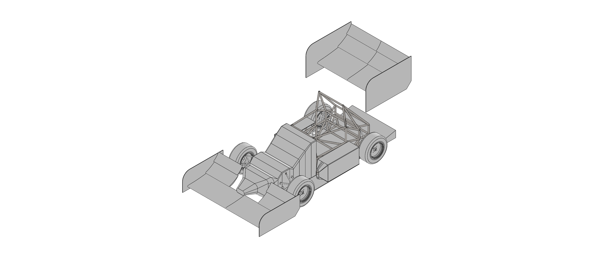
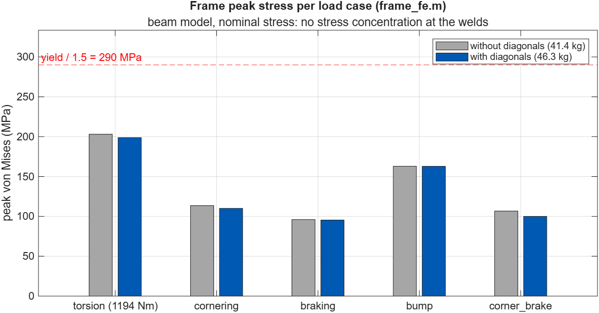

# Formula Single-Seater

A Formula-Student-sized electric single-seater, designed from one parameter file to a lap time. The CAD (SolidWorks 2026, built by scripts), the frame and suspension analysis (MATLAB), the aerodynamics (Ansys Fluent, Student licence) and a lap-time simulation (MATLAB, with a Simulink cross-check) all read the same `params/car_params.txt`.

The proportions follow Formula Student, but the rules do not: the wings are larger than the FS rules allow, because the aero brief was maximum downforce first.



## Rebuild in one command

With SolidWorks 2026 (Student is enough) and Python 3 installed:

```
python tools/sw_run.py rebuild
```

The command:
- closes SolidWorks without saving and starts it fresh;
- builds the chassis weldment from `cad/frame/*.csv` (123 tubes), trims every tube end and checks the result;
- builds the master layout, bodywork and wings, the assembly, and the 24 suspension parts;
- checks suspension clearance over ±30 mm travel and full steering lock, and runs the motion study and the frame beam studies;
- saves the standard views to `media/views/`.

Each step writes a report beside its output and stops at the first failure. The step list and the reports are described in `tools/README.md`.

The frame CSVs and the suspension hardpoints come from MATLAB. After changing the parameters, run these first (MATLAB R2026a, from `matlab/`):

```matlab
addpath('common'); setup_paths();
frame_layout(struct('plot', false, 'write', true));   % cad/frame/frame_nodes.csv, frame_tubes.csv
frame_trims();                                         % cad/frame/frame_trims.csv
load_cases();                                          % sim/stress/load_cases.csv
make_media();                                          % GIF, stress plots, mass and lap tables in media/
run_all('test')                                        % 24 self-tests
```

`run_all` without arguments also re-runs the aero post-processing, which writes into `cfd/results/`.

## Results

All numbers come from the scripts named in the table, as of 2026-11-25. None of them is a measurement on a real car.

| Quantity | Value | Source |
|---|---|---|
| Mass, car without / with driver | 232.6 / 302.6 kg, 41.8 % front, CG 902 mm behind the front axle, 311 mm high | `matlab/mass_budget.m`, `media/mass_table.md` |
| Frame | 123 tubes of 25.4 mm 4130, 46.26 kg as the trimmed SOLIDWORKS weldment (48.7 kg on centre-line lengths, which count each coped end twice); no welds or brackets (6.4 kg allowance on its own line) | `params/car_params.txt`, `matlab/cad/frame_trimmed_mass.m` (CG) |
| Frame torsional stiffness | 1476 Nm/deg, 1.6 % under the 1500 target (834 without the 9 torsion diagonals; 1503 with a tenth, RT1-RRK, removed on 2026-11-25 because it met its cross tubes at 5.4 deg); a fused solid model in SOLIDWORKS Simulation gives 1470 (same load case, 2.9 M-node mesh) | `matlab/stress/frame_fe.m` (beam model), `tools/sw_harness/FrameAnalysis.cs` (solid cross-check) |
| Frame, lowest factor of safety on yield | 2.62, bump case (3 g total wheel load), nominal beam stress | `matlab/stress/frame_fe.m`, `docs/stress_frame.md` |
| Camber gain, front / rear | −0.039 / −0.043 deg/mm | `matlab/suspension_geometry.m` |
| Bump steer over ±30 mm, front / rear | 0.010 / 0.021 deg | same |
| Static roll centre, front / rear | 60 / 79 mm | same |
| Motion ratio, front / rear | 0.71 / 0.77 | same |
| Outer ball joint housing to rim barrel, smallest | 4.0 mm (rear upper joint), with a 12.5 mm housing radius assumed | `matlab/suspension_optimise.m` |
| Aero, as built (CP: variant C's wings on the SOLIDWORKS nose, sidepods and floor plate), half-car CFD | ClA 3.89 m², CdA 1.66 m², L/D 2.34, 43 % on the front axle (unsteady, mean good to about 1 %) | `media/cfd/cfd_results.md`, `params/aero_variants.csv` |
| Lap time, FS-style autocross, as built (CP) | 61.12 s point-mass, 62.12 s with four-wheel load transfer | `media/lap_time_table.md`, `media/results_table.md` |
| Lap time, fast circuit, as built (CP) | 82.97 s point-mass, 83.08 s four-wheel | same |
| Wings worth (A no wings → C, like for like), autocross / fast circuit | 5.60 s / 1.63 s | same |
| Skidpad / 75 m acceleration, as built (CP) | 4.89 s / 4.35 s; 0–100 km/h 3.47 s | `matlab/accel_test.m`, lap sim |
| Simulink 75 m model vs MATLAB (CP) | 4.3499 s vs 4.3499 s | `matlab/simulink/run_accel_simulink.m` |
| Following one car length behind (CP) | 64 % of the free-stream dynamic pressure in the follower's window (CP's own wake); +2.14 s autocross, +1.21 s fast circuit | CFD wake plane, `matlab/lapsim/lap_experiments.m` |
| Cornering balance at a 45 m radius (CP, four-wheel) | 112.9 km/h, rear axle at its limit first, balance −6.5 % (front use minus rear use); neutral with 39 % of the aero load on the front axle against the 43 % CP has | `matlab/lapsim/cornering_balance_study.m`, `media/cornering_balance.md` |

### Lap times, aero variants (point-mass)

CP is the car as built: C's wings on the SOLIDWORKS nose, sidepods and 10 mm floor plate. It is the reference everywhere else in the repo (load cases, stress cases, cornering balance, sensitivity). Since 2026-11-25, **B and D are on the same as-built bodywork as CP** (CFD runs B_AB and D_AB), so B, D and CP compare like for like. A and C are still on the older CFD bodywork.

**D's diffuser is 12° in this comparison, not 14°.** The 14° diffuser would not mesh on the as-built bodywork. D_AB was also meshed with 1 prism layer instead of 2, to stay under the cell limit; on the old bodywork that change moved ClA by −0.2 % and CdA by −1.0 %. The old B and D results (older bodywork, 14° diffuser) are in `params/aero_variants_simplified_BD.csv`.

| Track | A no wings | B moderate, as built | C maximum | D wake-tuned, as built, 12° diffuser | **CP as built** |
|---|---|---|---|---|---|
| skidpad | 5.12 s | 4.92 s | 4.89 s | 4.89 s | **4.89 s** |
| accel 75 m | 4.41 s | 4.34 s | 4.35 s | 4.34 s | **4.35 s** |
| autocross | 66.59 s | 61.72 s | 60.99 s | 60.90 s | **61.12 s** |
| fast circuit | 84.15 s | 79.90 s | 82.52 s | 84.26 s | **82.97 s** |

On the fast circuit the drag of C and D costs more than their downforce gains, because the car is power-limited on the straights (80 kW). The SOLIDWORKS bodywork costs 0.13 s on the autocross and 0.45 s on the fast circuit against C (ClA −2.3 %, CdA +1.6 %).

### B, D and CP on the same as-built bodywork

From half-car CFD at 20 m/s. Steady RANS on a Student mesh, so **only the ranking is trustworthy**. Wake q-ratio is the follower's window average at 1 / 2 / 3 car lengths behind the rear axle (1 = clean air). Lap times are point-mass. The following penalty puts the same car behind, one length back, in that variant's own wake.

| | B (as built) | D (as built, **12° diffuser**) | CP (as built) | B old | D old |
|---|---|---|---|---|---|
| ClA / CdA (m²) | 3.36 / 1.32 | 4.03 / 1.76 | 3.89 / 1.66 | 3.43 / 1.29 | 4.20 / 1.77 |
| L/D, front axle share | 2.54, 0.43 | 2.29, 0.39 | 2.34, 0.43 | 2.65, 0.45 | 2.38, 0.38 |
| Wake q-ratio at 1 / 2 / 3 L | 0.67 / 0.89 / 0.95 | 0.65 / 0.92 / 0.98 | 0.64 / 0.92 / 0.98 | 0.66 / 0.86 / 0.93 | 0.65 / 0.92 / 0.97 |
| Skidpad / autocross / fast circuit (s) | 4.92 / 61.72 / 79.90 | 4.89 / 60.90 / 84.26 | 4.89 / 61.12 / 82.97 | 4.92 / 61.64 / 79.79 | 4.88 / 60.65 / 84.31 |
| Following penalty, autocross / fast circuit (s) | +1.69 / +1.14 | +2.14 / +1.14 | +2.14 / +1.21 | +1.80 / +1.23 | +2.21 / +1.09 |

On the as-built bodywork:
- B loses 2 % of its old downforce and D 4 %. Part of D's loss is the shallower 12° diffuser.
- The ranking is unchanged from the old bodywork:
  - D is fastest on the skidpad and autocross.
  - B is fastest on the power-limited fast circuit.
  - B leaves the cleanest air at 1 L.
  - D and CP clean up faster by 2 to 3 L.
Full tables: `media/cfd/cfd_results.md`, `media/results_table.md`, `media/lap_as_built_BD.csv`.

### Frame torsion diagonals: before and after

| | Before | After |
|---|---|---|
| Torsional stiffness (through the suspension links) | 834 Nm/deg | 1476 Nm/deg |
| Frame tubes (trimmed-weldment mass; centre-line 43.5 / 48.7 kg) | 41.4 kg | 46.3 kg |
| Car without driver | 227.0 kg | 232.6 kg |
| Autocross, as built (CP), point-mass / four-wheel | 60.90 / 61.97 s | 61.12 / 62.12 s |
| Fast circuit, as built (CP), point-mass / four-wheel | 82.87 / 82.99 s | 82.97 / 83.08 s |

The lap sim treats the chassis as rigid. It therefore shows only the cost of the added mass (+0.22 s on the autocross), not any benefit of the stiffer frame.

The diagonals were chosen by `matlab/stress/frame_diagonal_search.m`: the lightest set that reaches 1500 Nm/deg, clears the driver, battery, motor and diff envelopes, and meets no frame tube at under 10 deg. Floor diagonals alone reach 1161 Nm/deg, and floor plus top diagonals reach 1354. The sidepod tops and the front bulkhead plane are also needed. The search's chosen set had a tenth tube, RT1-RRK (rear top, ahead of the rocker mount). It was removed on 2026-11-25: it met the RT1 and RRK cross tubes, 60 mm apart, at 5.4 deg, so it could only be built as a gouged joint about 270 mm long at each end. Without it the frame gives 1476 Nm/deg. The lightest way back to 1500 is its twin behind the rocker mount (RRK-RT2, 1501 Nm/deg, +0.59 kg, 12.3 deg joints); nothing lighter reaches the target. It was not added.

### Media

| File | What |
|---|---|
| `media/views/*_iso.png` and the other five views | SolidWorks standard views of the chassis, the assembly, the master layout, the suspension (corners and frame only) and the fused analysis frame |
| `media/suspension_bump_steer.gif` | front and rear corner through ±30 mm of travel, then the front corner lock to lock (MATLAB kinematics) |
| `media/frame_stress_cases.png`, `frame_stress_bump.png`, `frame_torsion_diagonals.png`, `frame_fe.png` | frame stress per load case, the bump case on the frame, stiffness by diagonal family, deformed shapes |
| `media/mass_table.md`, `media/lap_time_table.md`, `media/results_table.md` | mass budget, lap times, aero before/after CFD |
| `media/cfd/` | CFD forces, convergence, wake planes |




## Assumptions and limits

These are the things the numbers above depend on that were not measured, or were simplified.

- **Tyres.** Friction is assumed: μ 1.40 at 750 N with a load-sensitivity exponent of 0.10. There is no tyre data behind these values. The lap times and the cornering balance move with both. On the autocross, 10 % less grip costs 3.8 s and 10 % more gains 3.2 s.
- **Aero.**
  - The CFD is a half car, steady RANS (k-ω SST), one mesh per variant, with no mesh-independence or y+ study and no wind-tunnel or track comparison. Only the ranking of the variants is trustworthy; the absolute ClA and CdA may be off by tens of percent.
  - Variant A's downforce did not converge.
  - B and D were re-solved on the as-built bodywork (runs B_AB, D_AB). **D's diffuser there is 12°, not D's 14°:** at 14° the diffuser roof grazes the as-built hull, and the two fixes tried failed to mesh. D_AB has 1 prism layer instead of 2 (cell limit). A and C stay on the older CFD bodywork.
  - The front/rear aero split is an estimate. The balance target used for trimming (0.40 front) is a target, not a result.
- **CFD mesh limit.** The Ansys Student licence stops at 1,048,576 cells (measured: above that, Fluent Meshing exits without writing a mesh). The meshes are 0.27 to 1.04 M cells, so the near-wall resolution and the far wake are coarse.
- **Roll centres** are static: computed at ride height and held fixed with roll in the cornering model.
- **No anti-roll bar.** The roll stiffness split (38 % front) comes from the ride frequencies alone; tyre stiffness is ignored.
- **Frame stiffness and stress** come from a MATLAB beam model:
  - rigid joints at the node centres;
  - no weld detail, no stress concentration, no fatigue.
  - It is self-tested against hand calculations for single tubes.
  - **Torsional stiffness is confirmed by a solid model.** A separate analysis-only solid frame (`cad/analysis/frame_analysis.SLDPRT`, built from the same tube data, tube ends overlapping their neighbours by 1 mm and fused into one body) gives 1470 Nm/deg against the beam model's 1476 in the headline case, and 1350 against 1365 with couples at the nodes (123 tubes, 2026-11-25). Going from a 5 mm to a 4 mm mesh changes this by 0.3 %; a 3 mm mesh failed to mesh on the Student licence (see `docs/stress_frame.md`).
  - **Stresses are not confirmed.** The solid model's peaks sit where the point loads enter and are not used. The frame stresses and factors of safety are the beam model's nominal values.
  - **What neither model includes:** both assume perfectly fused joints, with no welds as built, no brackets and no fabrication tolerances. The real frame will be softer than both by an amount neither can predict. Only a physical torsion test would settle it.
- **Mass and CG.** 24 % of the mass is a placeholder (flag GUESS in `media/mass_table.md`), including the brackets and welds, the inverter, the wings and the bodywork. The CG height is therefore partly a guess too.
- **Lap simulation.**
  - Quasi-steady, perfect driver, no transients.
  - The point-mass model has no load transfer. The four-wheel model adds steady load transfer at the corner limit only.
  - The chassis is rigid in both.
  - Use the lap times to compare set-ups, not to predict a real lap.
- **Suspension.**
  - The kinematics have rigid links and bushings with no compliance.
  - The ball-joint housing size (12.5 mm radius) is an assumption: an Aurora COM-5T spherical bearing (5/16 in bore, 19.05 mm OD) in a 3 mm-wall steel cup.
  - The SOLIDWORKS motion study reaches only +23 mm (front) and +14 mm (rear) of bump, against the ±30 mm asked for. The cause is not found. The ±30 mm clearance check is done instead by the SuspensionCheck step, which poses the corners directly.
  - The rear lower wishbone and pushrod tubes overlap by 7–13 mm³ near their shared outer joint at droop and static (SuspensionCheck warning). The links are modelled as plain tubes meeting at the joint centre; real rod ends and a clevis would set their spacing.
- **Packaging.** The driver is represented by boxes (legs, torso) and a helmet sphere, not a manikin. The pedal box has no envelope of its own; the frame keeps the window between the FS2 cross tubes free for it. The frame clearances are checked against these boxes only.

## Repository layout

```
params/     car_params.txt (single source of truth, with the mass and CG budget), suspension_hardpoints.txt, aero tables
cad/        SolidWorks parts and assemblies, frame/ (node, tube and trim CSVs), analysis/ (fused solid frame for the torsion cross-check), generate/ (Python geometry), macros/
matlab/     run_all, make_media, mass_budget, suspension_geometry, suspension_optimise, load_cases; cad/ (frame_layout, frame_trims),
            stress/ (frame_fe, frame_diagonal_search), lapsim/, simulink/, aero/, cfd/
tools/      sw_run.py and the C# SolidWorks harness (sw_harness/), README with every step
sim/        stress/ and motion/ reports
cfd/        Fluent set-up, journals, results
docs/       log.md (newest summary at the top), stress_frame.md, concept and playbook notes
media/      figures, GIF, tables, SolidWorks views
```

## Licence

MIT for the scripts and macros (`LICENSE`), CC BY 4.0 for the CAD and renders (`LICENSE-CAD`).
